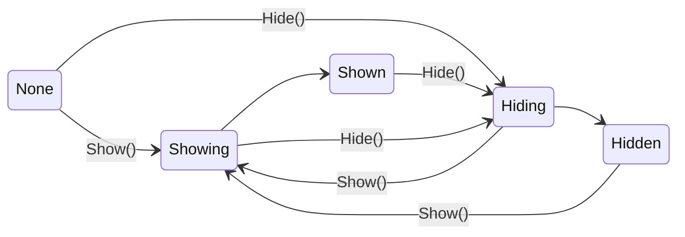
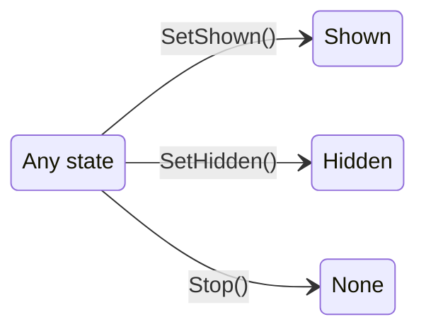
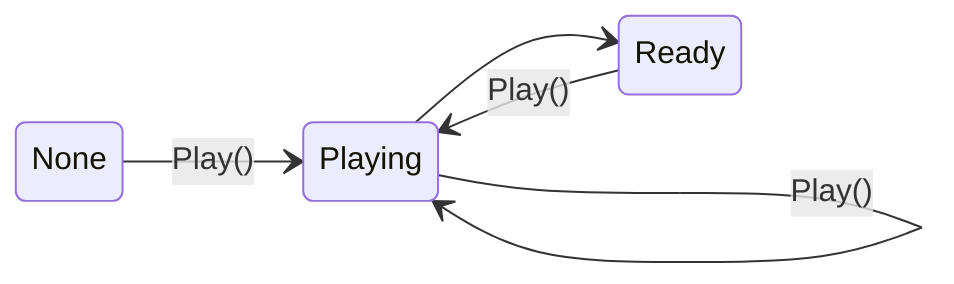
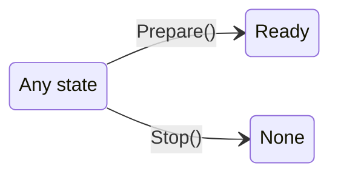

English | [Русский](README.ru.md)

# StatefulEffects

A library that brings effects in Unity to a single interface. The controlling code works with an effect only through this interface, so the effect itself can be built on anything: Animator, tweens, coroutines, particles or UI. As a result:
- an effect can be replaced with another one without changing the controlling code;
- game scenarios are written once and work with any effects.

## Installation

Unity 2021.3 or newer. Package Manager → *Add package from git URL*:

```
https://github.com/CatCodeGames/StatefulEffects.git?path=Assets/StatefulEffects
```

# ShowHide

An interface and base classes for objects and effects with two stable states and transitions between them. Suitable for windows, panels, long-running effects and anything that turns on and off.

## States

- `Hidden` — the object is hidden or inactive
- `Showing` — transition to `Shown`
- `Shown` — the object is visible or active
- `Hiding` — transition to `Hidden`
- `None` — the state is unknown: control has not started yet or was stopped with `Stop()`

The current state is stored in `State`, and the `OnStateChanged` event is raised when it changes.

Animated transitions:



Instant commands work from any state:



## Example

```csharp
[SerializeField] private MonoShowHide _portalPrefab;

public async UniTask SpawnPortal(CancellationToken token)
{
    var portal = Instantiate(_portalPrefab);
    portal.SetHidden();                 // set the initial state
    await portal.ShowAsync(token);      // show and wait until finished
    await SpawnEnemy();
    await portal.HideAsync(token);      // hide and wait until finished
}
```

`ShowAsync` and `HideAsync` are available when UniTask is installed. Without it, use `Show()`, `Hide()` and the `OnStateChanged` event.

## MonoShowHide

Unity does not serialize interface fields, so inspector references are declared as `MonoShowHide`. It is an abstract `MonoBehaviour` that implements `IShowHide` without any logic of its own — essentially an interface for the inspector. Any implementation can be assigned to a `MonoShowHide` field.

## CallbackShowHide

A base for quickly implementing your own effect. A subclass describes only what the transitions and the end states look like, while the base class stores the state and handles commands.

- `OnShow`, `OnHide` — start the transition and call `onCompleted` when it ends
- `OnSetShown`, `OnSetHidden` — apply the end look immediately
- `OnStop` — stop the transition

Each method receives `from` — the state before the command. With `from == None` the object's look is unknown, so the method first brings the object to its initial look.

### Command Handling

The inspector sets command handling separately for showing and for hiding:
- **During a transition** (`OnInterrupt`): the opposite command reverses the transition (`Accept`, default) or is rejected (`Ignore`).
- **In the end state** (`OnRepeat`): a repeated command is rejected (`Ignore`, default) or plays the transition again (`Restart`).

### Example Implementation

```csharp
public sealed class ScaleShowHide : CallbackShowHide
{
    private Tween _tween;

    protected override void OnShow(ShowHideState from, Action onCompleted)
    {
        if (from == ShowHideState.None)
            transform.localScale = Vector3.zero;

        _tween?.Kill();
        _tween = transform.DOScale(Vector3.one, 1f).OnComplete(() => onCompleted());
    }

    protected override void OnHide(ShowHideState from, Action onCompleted)
    {
        if (from == ShowHideState.None)
            transform.localScale = Vector3.one;

        _tween?.Kill();
        _tween = transform.DOScale(Vector3.zero, 1f).OnComplete(() => onCompleted());
    }

    protected override void OnSetShown(ShowHideState from)
    {
        _tween?.Kill();
        transform.localScale = Vector3.one;
    }

    protected override void OnSetHidden(ShowHideState from)
    {
        _tween?.Kill();
        transform.localScale = Vector3.zero;
    }

    protected override void OnStop(ShowHideState from)
    {
        _tween?.Kill();
    }
}
```

# EffectAction

An interface and base classes for one-shot effects: the effect plays and returns the object to its initial look. Suitable for flashes, hits, particle bursts and anything that starts and finishes by itself. If the object has to be returned to its initial look separately after the effect, use ShowHide.

## States

- `Ready` — the object is in its initial look, the effect is ready to play
- `Playing` — the effect is playing, then `Ready`
- `None` — the state is unknown: control has not started yet or was stopped with `Stop()`

The current state is stored in `State`, and the `OnStateChanged` event is raised when it changes.

Playback:



Instant commands work from any state:



## Example

```csharp
[SerializeField] private MonoEffectAction _explosionPrefab;

public async UniTask Explode(CancellationToken token)
{
    var explosion = Instantiate(_explosionPrefab);
    explosion.Prepare();                    // set the initial state
    await explosion.PlayAsync(token);       // play and wait until finished
    Destroy(explosion.gameObject);
}
```

`PlayAsync` is available when UniTask is installed. Without it, use `Play()` and the `OnStateChanged` event.

## MonoEffectAction

For the same reason as with ShowHide, inspector references are declared as `MonoEffectAction`. It is an abstract `MonoBehaviour` that implements `IEffectAction` without any logic of its own — essentially an interface for the inspector. Any implementation can be assigned to a `MonoEffectAction` field.

## CallbackEffectAction

A base for quickly implementing your own effect. A subclass describes only how the effect plays and what its initial look is, while the base class stores the state and handles commands.

- `OnPlay` — start the effect and call `onCompleted` when it ends
- `OnPrepare` — return the object to its initial look immediately
- `OnStop` — stop the effect

Each method receives `from` — the state before the command. With `from == None` the object's look is unknown, so the method first brings the object to its initial look. With `from == Playing` the effect is already running, and the method decides whether to restart it or play another one on top.

### Command Handling

The inspector sets handling of a repeated command:
- **During playback** (`OnRepeat`): a repeated `Play()` is passed to the implementation, which restarts the effect or plays another one on top (`Accept`, default), or is rejected (`Ignore`).

### Example Implementation

```csharp
public sealed class PunchScaleEffect : CallbackEffectAction
{
    private Tween _tween;

    protected override void OnPlay(EffectActionState from, Action onCompleted)
    {
        _tween?.Kill();
        transform.localScale = Vector3.one;
        _tween = transform.DOPunchScale(Vector3.one * 0.2f, 0.3f).OnComplete(() => onCompleted());
    }

    protected override void OnPrepare(EffectActionState from)
    {
        _tween?.Kill();
        transform.localScale = Vector3.one;
    }

    protected override void OnStop(EffectActionState from)
    {
        _tween?.Kill();
    }
}
```
