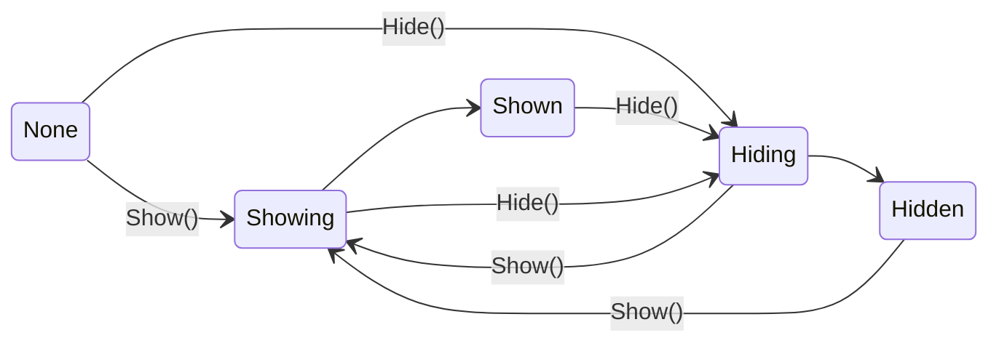
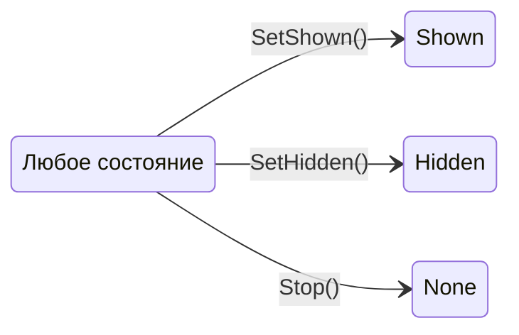
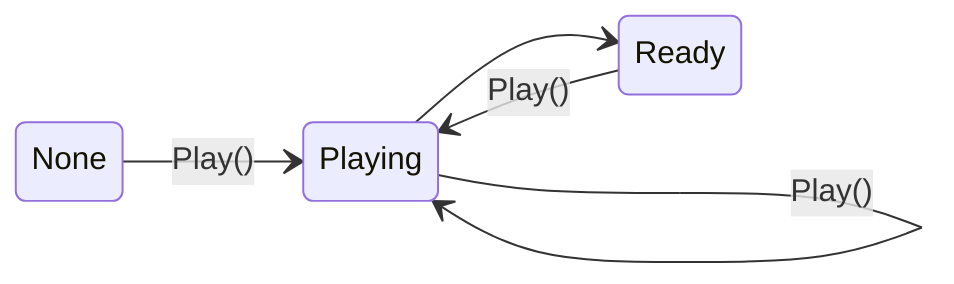
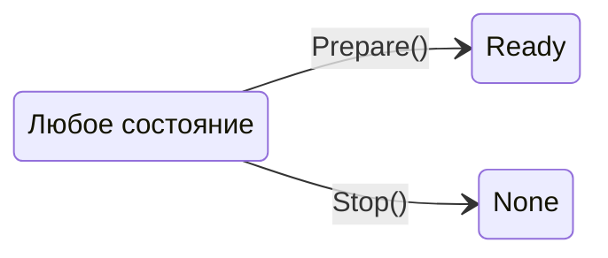

[English](README.md) | Русский

# StatefulEffects

Библиотека, которая приводит эффекты в Unity к единому интерфейсу. Управляющий код работает с эффектом только через этот интерфейс, поэтому сам эффект может быть построен на чём угодно: Animator, твинах, корутинах, частицах или UI. Благодаря этому:
- эффект можно заменить другим без изменения управляющего кода;
- игровые сценарии пишутся один раз и работают с любыми эффектами.

## Установка

Unity 2021.3 и новее. Package Manager → *Add package from git URL*:

```
https://github.com/CatCodeGames/StatefulEffects.git?path=Assets/StatefulEffects
```

# ShowHide

Интерфейс и базовые классы для объектов и эффектов с двумя устойчивыми состояниями и переходами между ними. Подходит для окон, панелей, продолжительных эффектов и всего, что включается и выключается.

## Состояния

- `Hidden` — объект скрыт или неактивен
- `Showing` — переход в `Shown`
- `Shown` — объект виден или активен
- `Hiding` — переход в `Hidden`
- `None` — состояние неизвестно: управление ещё не начато или остановлено через `Stop()`

Текущее состояние хранится в `State`, при его смене вызывается событие `OnStateChanged`.

Плавные переходы:



Мгновенные команды выполняются из любого состояния:



## Пример

```csharp
[SerializeField] private MonoShowHide _portalPrefab;

public async UniTask SpawnPortal(CancellationToken token)
{
    var portal = Instantiate(_portalPrefab);
    portal.SetHidden();                 // задать исходное состояние
    await portal.ShowAsync(token);      // показать и дождаться окончания
    await SpawnEnemy();
    await portal.HideAsync(token);      // скрыть и дождаться окончания
}
```

`ShowAsync` и `HideAsync` доступны при установленном UniTask. Без него используются `Show()`, `Hide()` и событие `OnStateChanged`.

## MonoShowHide

Unity не сериализует поля интерфейсного типа, поэтому ссылки в инспекторе объявляются как `MonoShowHide`. Это абстрактный `MonoBehaviour`, реализующий `IShowHide` без собственной логики, — по сути интерфейс для инспектора. Полю типа `MonoShowHide` назначается любая реализация.

## CallbackShowHide

Основа для быстрой реализации своего эффекта. Наследник описывает только то, как выглядят переходы и конечные состояния, а хранение состояния и обработку команд берёт на себя базовый класс.

- `OnShow`, `OnHide` — запустить переход и по окончании вызвать `onCompleted`
- `OnSetShown`, `OnSetHidden` — сразу применить конечный вид
- `OnStop` — остановить переход

Каждый метод получает `from` — состояние до команды. При `from == None` вид объекта неизвестен, и метод сначала приводит объект в исходный вид.

### Реакция на команды

В инспекторе для показа и для скрытия отдельно задаётся реакция на команды:
- **Во время перехода** (`OnInterrupt`): противоположная команда разворачивает переход (`Accept`, по умолчанию) или отклоняется (`Ignore`).
- **В конечном состоянии** (`OnRepeat`): повторная команда отклоняется (`Ignore`, по умолчанию) или запускает переход заново (`Restart`).

### Пример реализации

```csharp
public sealed class ScaleShowHide : CallbackShowHide
{
    private Tween _tween;

    protected override void OnShow(ShowHideState from, Action onCompleted)
    {
        if (from == ShowHideState.None)
            transform.localScale = Vector3.zero;

        _tween?.Kill();
        _tween = transform.DOScale(Vector3.one, 1f).OnComplete(() => onCompleted());
    }

    protected override void OnHide(ShowHideState from, Action onCompleted)
    {
        if (from == ShowHideState.None)
            transform.localScale = Vector3.one;

        _tween?.Kill();
        _tween = transform.DOScale(Vector3.zero, 1f).OnComplete(() => onCompleted());
    }

    protected override void OnSetShown(ShowHideState from)
    {
        _tween?.Kill();
        transform.localScale = Vector3.one;
    }

    protected override void OnSetHidden(ShowHideState from)
    {
        _tween?.Kill();
        transform.localScale = Vector3.zero;
    }

    protected override void OnStop(ShowHideState from)
    {
        _tween?.Kill();
    }
}
```

# EffectAction

Интерфейс и базовые классы для разовых эффектов: эффект проигрывается и возвращает объект в исходный вид. Подходит для вспышек, ударов, взрывов частиц и всего, что запускается и завершается само. Если после эффекта объект нужно отдельно возвращать в исходный вид, подойдёт ShowHide.

## Состояния

- `Ready` — объект в исходном виде, эффект готов к запуску
- `Playing` — эффект проигрывается, по окончании `Ready`
- `None` — состояние неизвестно: управление ещё не начато или остановлено через `Stop()`

Текущее состояние хранится в `State`, при его смене вызывается событие `OnStateChanged`.

Проигрывание:



Мгновенные команды выполняются из любого состояния:



## Пример

```csharp
[SerializeField] private MonoEffectAction _explosionPrefab;

public async UniTask Explode(CancellationToken token)
{
    var explosion = Instantiate(_explosionPrefab);
    explosion.Prepare();                    // задать исходное состояние
    await explosion.PlayAsync(token);       // проиграть и дождаться окончания
    Destroy(explosion.gameObject);
}
```

`PlayAsync` доступен при установленном UniTask. Без него используются `Play()` и событие `OnStateChanged`.

## MonoEffectAction

По той же причине, что и у ShowHide, ссылки в инспекторе объявляются как `MonoEffectAction`. Это абстрактный `MonoBehaviour`, реализующий `IEffectAction` без собственной логики, — по сути интерфейс для инспектора. Полю типа `MonoEffectAction` назначается любая реализация.

## CallbackEffectAction

Основа для быстрой реализации своего эффекта. Наследник описывает только то, как выглядят проигрывание и исходный вид, а хранение состояния и обработку команд берёт на себя базовый класс.

- `OnPlay` — запустить эффект и по окончании вызвать `onCompleted`
- `OnPrepare` — сразу вернуть объект в исходный вид
- `OnStop` — остановить эффект

Каждый метод получает `from` — состояние до команды. При `from == None` вид объекта неизвестен, и метод сначала приводит объект в исходный вид. При `from == Playing` эффект уже идёт, и метод решает, перезапустить его или запустить ещё один поверх.

### Реакция на команды

В инспекторе задаётся реакция на повторную команду:
- **Во время проигрывания** (`OnRepeat`): повторный `Play()` передаётся реализации, которая перезапускает эффект или запускает ещё один поверх (`Accept`, по умолчанию), или отклоняется (`Ignore`).

### Пример реализации

```csharp
public sealed class PunchScaleEffect : CallbackEffectAction
{
    private Tween _tween;

    protected override void OnPlay(EffectActionState from, Action onCompleted)
    {
        _tween?.Kill();
        transform.localScale = Vector3.one;
        _tween = transform.DOPunchScale(Vector3.one * 0.2f, 0.3f).OnComplete(() => onCompleted());
    }

    protected override void OnPrepare(EffectActionState from)
    {
        _tween?.Kill();
        transform.localScale = Vector3.one;
    }

    protected override void OnStop(EffectActionState from)
    {
        _tween?.Kill();
    }
}
```
